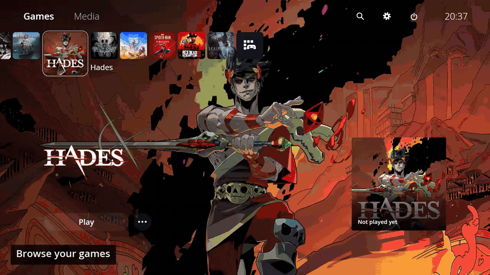

<div align="center">

# Padwake

### A PS5-inspired UI for your Windows gaming PC.

Built with **Rust + Tauri**. Blazing-fast navigation. Made for a controller.

[](https://github.com/ddoinn/padwake/releases/latest) [](https://github.com/ddoinn/padwake/releases/latest) [](app/src-tauri) [](app/src-tauri/Cargo.toml) [](LICENSE)

**[Download for Windows](https://github.com/ddoinn/padwake/releases/latest)** · [Watch the tour](https://github.com/ddoinn/padwake/releases/download/v0.1.0/tour.mp4) · [Setup](docs/setup.md) · [Report a bug](https://github.com/ddoinn/padwake/issues)

</div>



## Your PC, with a console feel

- **PS5-inspired navigation.** A game row, full-screen artwork, spring motion, game hubs and a Guide-button Control Center.
- **Your games, in one place.** Pick a folder. Padwake finds games, fetches artwork, screenshots and trailers, and tracks playtime.
- **Get straight to playing.** Launch a game; the window hides and WebView2 suspends. Quit the game and your library comes back.
- **Everything on the controller.** Search, an on-screen keyboard, volume, display settings, power controls, mouse mode and a live button test.
- **Games and media.** Switch to YouTube, Netflix, Spotify, Twitch, Plex or Crunchyroll without leaving the launcher.

## Fast when you move. Quiet when you play.

| Measurement | Padwake v0.1.0 |
| :--- | ---: |
| Keypress → first moving frame | **30 ms** median |
| Game exit → Home answering input | **316 ms** median |
| Home idle — CPU | **0.083%** |
| Home idle — GPU | **0.006%** average |
| While a game runs — CPU | **0.058%** |
| While a game runs — GPU | **0%** measured |

Measured on a Ryzen 5 3500U laptop at 1080p / 60 Hz. CPU is a percentage of the whole machine and includes the app, WebView2 and watchdog. [Results, limits and reproduction steps →](docs/performance.md)

## Install

1. Download the Windows x64 ZIP from [Releases](https://github.com/ddoinn/padwake/releases/latest).
2. Extract it to a writable folder and run `padwake.exe`.
3. Choose your games folder in **Settings → Library**. One folder per game.

Windows 10/11, x64. Requires **Microsoft Edge WebView2**. No installer; settings and artwork live in `data/` beside the app. FFmpeg is included in the release for trailers. [Artwork and startup setup →](docs/setup.md)

## Controls

| Xbox controller | Action |
| :--- | :--- |
| D-pad / left stick | Navigate; hold to scroll faster |
| **A** | Select, play or resume |
| **B** | Back; hold for one second to leave the button test |
| **Y** | Search from Home or Library |
| **LB / RB** | Switch tabs; previous / next screenshot |
| **LT / RT** | Jump through game rows, grids and hub cards |
| **Menu** | Options for the focused game; sorting in Library |
| **Guide — tap** | Open / close Control Center, including over a game |
| **Guide — hold** | Go Home |

<details>
<summary><strong>Typing, mouse mode and keyboard shortcuts</strong></summary>

### On-screen keyboard

| Button | Action |
| :--- | :--- |
| A / B | Enter the focused key / cancel |
| X / Y | Delete / space |
| LB / RB | Move the text cursor |
| LT | Shift |
| RT / Menu | Done |
| View | Show / hide a password |

### Mouse mode

Enable it in Control Center. Right stick moves the cursor, left stick scrolls, **A** clicks or drags, **X** right-clicks, and **B** or **Guide** exits.

### Keyboard

| Key | Controller equivalent |
| :--- | :--- |
| Arrow keys | D-pad |
| Enter / Space | A |
| Esc / Backspace | B |
| X / Y | X / Y |
| Q / E | LB / RB |
| Page Up / Page Down | LT / RT |
| M / Context Menu | Menu |
| V | View |
| Home — tap / hold | Guide — tap / hold |

A physical keyboard can type directly into text fields. Mouse navigation also works. Check every button, trigger, stick and stick click in **Settings → Controllers → Test Buttons**.

</details>

## See it in use

**[23-second tour](https://github.com/ddoinn/padwake/releases/download/v0.1.0/tour.mp4)** · **[Launch a game and return Home](https://github.com/ddoinn/padwake/releases/download/v0.1.0/launch-and-return.mp4)**

Both clips show the native Windows app. The launch clip uses a labelled test game, not gameplay footage.

## Build from source

You'll need Node.js, Rust's MSVC toolchain, Visual Studio C++ Build Tools and WebView2.

```powershell
git clone https://github.com/ddoinn/padwake.git
cd padwake/app
npm ci
npm run tauri -- build --no-bundle
```

Rust handles controller input, game processes and Windows integration. Tauri + WebView2 render the HTML/CSS/JavaScript UI. [Development and tests →](DEVELOPMENT.md)

## Contributing

Found a bug? [Open an issue](https://github.com/ddoinn/padwake/issues) with your Windows version, controller model and the steps to reproduce it. Short recordings help with UI issues.

Controller testing, performance work, UI fixes and small PRs are welcome. For bigger changes, open an issue first. [Contribution guide →](CONTRIBUTING.md)

## Releases & license

**[v0.1.0](https://github.com/ddoinn/padwake/releases/tag/v0.1.0)** is the first Windows release. Downloads, checksums and changes are on the [releases page](https://github.com/ddoinn/padwake/releases).

**[MIT licensed](LICENSE)**; Open Sans uses the SIL Open Font License. [Third-party notices →](NOTICE)

Inspired by the PS5 interface. No Sony assets are included in the app, and Padwake is not affiliated with Sony.
